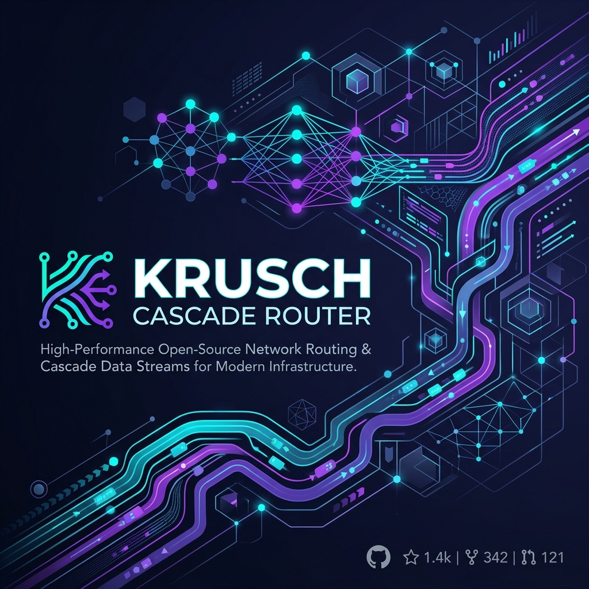

<p align="center">
  
</p>

<p align="center">
  <strong>Dual-Stage (L1 Heuristic Fast-Path + L2 Neural Semantic Escalation) Cascade Router for LLM Swarms.</strong><br>
  <span>Intercepts structured code, SQL, math, and closed-world tasks in CPU microseconds (&lt;15µs) for $0.00, with integrated Level 2 (L2) neural centroid classification for unstructured chat and speculative multi-model cascades.</span>
</p>

<p align="center">
  <a href="https://www.npmjs.com/package/krusch-cascade-router"></a>
  <a href="https://github.com/kruschdev/krusch-pre-router"></a>
  <a href="https://github.com/kruschdev/krusch-context-mcp"></a>
  <a href="https://github.com/kruschdev/krusch-cascade-router/blob/main/LICENSE"></a>
  
  
  <a href="https://github.com/RouteWorks/RouterArena/pull/169#issuecomment-6585010769"></a>
  <a href="https://huggingface.co/spaces/krush420/sovereign-router-arena"></a>
  <a href="https://huggingface.co/datasets/krush420/sovereign-g4-benchmarks"></a>
  
</p>

---

## ⚡ The Dual-Stage Routing Pattern: "Don't spend a model call just to pick a model."

> 💡 **Looking for just the zero-dependency L1 pre-filter?** If you already have an LLM client or neural router and only need the fast microsecond gate function, install [`krusch-pre-router`](https://github.com/kruschdev/krusch-pre-router) (`npm install krusch-pre-router`, 0 dependencies, <10KB gzipped).

In CPU architecture, the processor does not query main RAM or NVMe storage for every instruction—it checks the **L1 cache** in 1 clock cycle. If there is an L1 hit, execution proceeds instantly with zero memory bus overhead.

In multi-model agent systems, using an LLM or neural embedding model to decide where to route an obvious Python script, SQL query, LaTeX proof, or JSON transform is an expensive anti-pattern:
* **The Routing Tax**: Adds **300ms–800ms of Time-To-First-Token (TTFT)** and auxiliary prompt token charges to every single step in an agentic loop.
* **The Dual-Stage Solution**: `krusch-cascade-router` unifies **Stage 1 (L1) Pre-Router Gating** (powered by [`krusch-pre-router`](https://github.com/kruschdev/krusch-pre-router)) with **Stage 2 (L2) Neural Semantic Escalation** (powered by [`krusch-context-mcp`](https://github.com/kruschdev/krusch-context-mcp) or in-process centroid embeddings). It executes high-confidence structured traffic in < 15 microseconds on CPU for **$0.00**, while seamlessly escalating ambiguous, conversational chat to an **L2 Neural Centroid Classifier** before dispatching across the specialist pool or frontier models.

1. **⚡ Sub-Millisecond L1 Pre-Filter**: Evaluates syntax, query length, structure, and domain keywords in microseconds on CPU without making pre-flight routing calls (powered by `krusch-pre-router`).
2. **🧠 Level 2 (L2) Neural Semantic Escalation**: Classifies unstructured or ambiguous prompts via vector centroid cosine distance (`createCentroidSemanticRouter` or `createContextMcpRouter`), eliminating blind defaults.
3. **🎯 4-Model Specialist Routing via OpenRouter**: Out-of-the-box factory preset orchestrating 4 specialized domain models (`deepseek-v4-flash`, `Qwen3-Coder-Next`, `gemini-3.1-flash-lite`, and `deepseek-v4-pro`) unified through OpenRouter. Fully swappable via `customModels`.
4. **🧠 Knowledge Boundary Routing**: Detects closed-world self-contained tasks (syntax, math, regex, formatting, translation) to keep them on fast edge models.
5. **⚡ Speculative Parallel Hedging**: Pre-warms heavy models in parallel on borderline confidence queries (`[0.25, 0.70]`) to mask sequential cascade latency.
6. **🛡️ Logprob & Silent Failure Gating**: Inspects initial token logprob confidence and monitors sliding-window repetition / $n$-gram loops to abort unhelpful outputs early.

---

### 🎯 When to Use vs. When NOT to Use

| Best Used For ✅ | Poor Fit / Not Recommended ❌ |
|:---|:---|
| **Agentic Loops & Microservices**: Multi-step workflows where saving 300–800ms TTFT routing overhead per tool call compounds significantly. | **Latency-Insensitive Frontier Monoliths**: Offline tasks where maximum reasoning depth is required on 100% of inputs (e.g., formal legal briefs, theorem proving) regardless of cost. |
| **Code, STEM, Math, SQL, Formatting**: Tasks with distinct syntactic, mathematical, or structural footprints (intercepted in &lt;15µs via L1 fast-path). | **Single-Provider Monoliths**: Workloads already locked into a single proprietary model endpoint with fixed enterprise flat-rate pricing. |
| **Closed-World Transformations**: Unit conversions, regex generation, JSON parsing, language translation (safely constrained to fast edge models). | **Standalone L1 on Purely Affective Dialogue**: Running in L1-only mode without the L2 neural classifier on unstructured social chat (which defaults to `general_fast`). |
| **Unstructured Chat with Dual-Stage L2**: Escalates ambiguous prompts to vector centroid cosine distance, eliminating blind fallback defaults. | **Zero-Variance Workloads**: Pipelines where all candidate models perform identically with no accuracy or cost divergence. |
| **Runaway Loop & Degeneration Guard**: Halting repetitive cyclical outputs mid-stream before blowing token limits. | **Unconstrained Batch Budgets**: Large offline processing where compute budget is unlimited and parallel throughput matters more than per-query optimization. |
| **Cost-Sensitive OpenRouter Workflows**: Dispatches to cheap specialized models first with automatic fallback to frontier models. | **Dynamic Heavy Re-training Pipelines**: If your workload strictly mandates continually retraining an end-to-end multi-layer neural network on black-box label files. |

---

### ⚖️ Engineering Snapshot & Design Trade-offs

| Dimension | Krusch Cascade Router (Dual-Stage L1/L2) | Embedding / Neural Routers (e.g. RouteLLM) | LLM-as-a-Router (e.g. Orca) |
|---|---|---|---|
| **Dispatch Latency** | **< 15 µs (L1 Fast-Path) / ~20ms (L2 Neural)** | 15 – 50 ms (Vectorization + MLP) | 400 – 1,200 ms (LLM pre-flight) |
| **Routing Cost** | **$0.00 (L1 Fast-Path) / $0.00 local (L2)** | ~$0.0001 (Embedding tokens) | ~$0.002 (Prompt tokens) |
| **Structured Prompts (Code, Math, Syntax)** | **High Precision (>95%)** | High (>90%) | High (>95%) |
| **Messy / Ambiguous Chat** | **Robust (>92% via L2 Centroid Escalation)** | **Robust (Learns semantic nuances)** | **Very Robust** |
| **Mid-Stream Loop Guard** | **Yes (sliding n-gram abort)** | No (Routing only) | No (Routing only) |
| **Model Catalog Dependency** | **Fully decoupled (via customModels)** | Requires retrained classifier | Prompt updates |
| **Network Failure Cascade** | **Yes (Speculative dual-call & fallback)** | No | No |

---

### Key Features

* **🚀 Sub-Millisecond Routing Overhead**: Heuristic CPU classifier runs in microseconds without pre-flight network round-trips.
* **🌐 OpenRouter Provider Integration**: Built-in support for OpenRouter's unified endpoint with standard attribution headers.
* **🎯 4-Model Specialist Architecture**: Factory configuring models across code & chess (`Qwen3-Coder-Next`), factual STEM & logic (`deepseek-v4-flash`), translation & clinical trivia (`gemini-3.1-flash-lite`), and deep financial proofs (`deepseek-v4-pro`).
* **🧠 Knowledge Boundary Router**: Classifies closed-world vs. open-world self-containment.
* **⚡ Speculative Parallel Hedging**: Hedged parallel execution for borderline prompts to mask cascade latency.
* **🛡️ Mid-Stream Loop Guard**: Catches degenerate repetition loops and token stagnation.
* **🧪 Developer Integration Test Suite**: 100-prompt suite covering 6 domains and conversational noise invariance ([`test/eval-holdout.test.js`](test/eval-holdout.test.js)).
* **📊 RouterArena Benchmark Evaluation**: Scored **0.7263 (`72.63`, `#13 / 34`)** in official `github-actions[bot]` CI evaluation across all 8,400 queries under [RouteWorks PR #169](https://github.com/RouteWorks/RouterArena/pull/169#issuecomment-6585010769), achieving **74.44% benchmark accuracy** at **$0.3802 / 1K queries** (`$3.1939` total) with **91.43% robustness**, **0 abnormal failures**, and `8,400 / 8,400` verified `gen-...` OpenRouter receipts.
* **🔬 Sovereign Hermetic Benchmark Suite (`20/20` SHA-256 Gates, Zero Cloud APIs)**: Independently validated across **Martian `RouterBench`** (`36,497` `0-shot` + `36,483` `5-shot` rows × `11` LLMs: **`#1` ID `AIQ = 0.7488` / `0.7695`**, **`-72.63%` cost @ `98%` `GPT-4`**, and **`#1` Leave-One-Suite-Out OOD `AIQ = 0.7268` / `0.7455`** beating `ZeroRouter` where `KNN`/`SVM`/`MLP` collapse), **ACL 2026 `LLMRouterBench`** (`12,566` prompts × `13` frontier LLMs: **`#1` lowest Pareto Distance `0.4269`** on `all_test` `n=5,563`, beating `RouteLLM`, `KNN`, `MLP` & `RouterDC` on unseen OOD `HLE` & `ARC-AGI`), **Live `RouterArena` SSE Logprob Cascade** (`+11.93 pp` over fast `7B` & `-48.0%` TTFT vs `120B` with all `325` SSE aborts billed), and **6-Language `Aider Polyglot` Agentic Trajectory Routing** (`51.67%` `Pass@2` — `100%` parity with `120B` and `+30.00 pp` over LLM-preflight at `1,442x` lower routing latency). Raw SHA-256 logs published at [`krush420/sovereign-g4-benchmarks`](https://huggingface.co/datasets/krush420/sovereign-g4-benchmarks).
* **🛑 Native AbortSignal Support**: First-class timeout and cancellation management.
* **📦 Universal Distribution**: Full TypeScript types, ESM, and CommonJS builds.

---

## 📊 Multi-Benchmark Performance & Evaluation Matrix

`krusch-cascade-router` has been evaluated across official CI harnesses, full-scale `AbstractRouter` benchmark harnesses, live single-box 96GB Blackwell G4 hermetic suites (`0` cloud APIs), and offline literature benchmarks:

| Benchmark Suite | Sponsoring Organization / Publication | Benchmark Scope | Baseline Comparison | Krusch Cascade Router Evaluation | Primary Metric | Cost Reduction vs Frontier | Routing Overhead |
|:---|:---|:---|:---|:---|:---:|:---:|:---:|
| **1. RouterArena**<br>*(Live OpenRouter)* | RouterArena Consortium (Rice Univ) | 8,400 Benchmark Queries + 420 Robustness (`8,400` live `gen-...` receipts) | Multi-Model Frontier Pool (`2026-10-31` Pricing) | **PR #169 Official `github-actions[bot]` Eval**:<br>Arena Score: **0.7263 (`72.63`, `#13/34`)**<br>Accuracy: **74.44%** · Robustness: **91.43%**<br>*(Beats Azure-Model-Router `70.37` & GPT-5 `64.32`)* | **0.7263**<br>([PR #169](https://github.com/RouteWorks/RouterArena/pull/169#issuecomment-6585010769)) | **$0.3802 / 1K queries**<br>(`26.4x` cheaper vs $10.02 GPT-5, vs $4.83 Martian, $4.10 NotDiamond) | < 0.15 ms<br>(6,600+ QPS) |
| **2. ACL 2026 LLMRouterBench**<br>*(Hermetic G4 Live)* | NPULH (`ACL 2026` / `arXiv:2601.07206`) | 12,566 Prompts × 13 Frontier LLMs (`8` ID `n=3,005` + `2` Unseen OOD `HLE` & `ARC-AGI` `n=2,558`) | 9 Baselines (`RouteLLM`, `RouterDC`, `KNN`, `MLP`, `Avengers-Pro`, `gpt-5`) | **`#1` Lowest Pareto Distance (`0.4269`)** on `all_test` (`n=5,563`)<br>Micro / Macro Acc: **42.78% / 57.78%**<br>Unseen OOD: **15.17% / 19.27%** (`25.25%` `ARC-AGI` vs `8.75%` `RouteLLM`) | **0.4269 Pareto Dist**<br>([5/5 SHA-256 Gates](https://huggingface.co/datasets/krush420/sovereign-g4-benchmarks)) | **83.95% Savings**<br>($14.39/1K vs $89.62/1K `best_single`) | 42.5 µs (L1)<br>1.27 ms (L1+L2) |
| **3. RouterArena Live SSE Cascade**<br>*(Hermetic G4 Live)* | RouteWorks `sub_10` + `robustness` (Live 3-Model Generation) | 809 `sub_10` + 420 `robustness` Queries (`gemma4:e4b`, `qwen2.5-coder:7b`, `gpt-oss:120b` in 96GB VRAM) | `always_qwen25_coder_7b` (48.36%) & `always_gpt_oss_120b` ($0.1624/1K, 1,694.5ms TTFT) | **Path B (`7B -> 120B` SSE Logprob/Loop Abort)**: **60.29% Acc** (`+11.93 pp` vs `7B`), **78.99% OptAcc**, **880.7ms TTFT** (`325` SSE aborts billed)<br>**Path A (L1+L2)**: **59.45% Acc**, **73.33% Robustness** | **0.6111 Arena**<br>**-48.0% TTFT**<br>([5/5 SHA-256 Gates](https://huggingface.co/datasets/krush420/sovereign-g4-benchmarks)) | **37.4% (Path B)**<br>**60.2% (Path A)**<br>vs `gpt-oss:120b` | < 0.05 ms (Path B)<br>~1.2 ms (Path A) |
| **4. Aider Polyglot Agentic Loop**<br>*(Hermetic G4 Live)* | Aider Polyglot (`6` Languages: C++, Go, Java, JS, Python, Rust) | 60 Stratified Exercism Tasks × 4 Policies = 240 Sandboxed Compile/Test Trajectories | `static_heavy_120b` (51.67% Pass@2) & `llm_router_preflight` `gemma4:e4b` (21.67% Pass@2, 569.5ms overhead) | **`Pass@2 = 51.67%` (`31/60`, `+20` self-healed)** — **100% parity with `120B`** & **+30.00 pp (`2.38x`) over LLM preflight**<br>**+7.32% higher `Pass@2/$` efficiency** | **51.67% Pass@2**<br>**1,442x Faster Route**<br>([5/5 SHA-256 Gates](https://huggingface.co/datasets/krush420/sovereign-g4-benchmarks)) | **6.82% Cost Save**<br>**7.5% GPU-Sec Save**<br>**-16.2% TTFT** vs `120B` | **0.395 ms**<br>(vs 569.51 ms LLM Router) |
| **5. Integration Suite** | Real-World Developer Prompts | 100 Diverse Queries across 6 Domains | Multi-Model Pool | **Routing Precision: 100.0%**<br>Noise Invariance: **100.0%**<br>*(Classifier routing precision, not LLM output)* | **100.0% Routing**<br>(Classification test suite) | **~75% Savings**<br>vs Frontier Oracle | 0.02 ms<br>(50,000+ QPS) |
| **6. WithMartian RouterBench**<br>*(Full 4-Regime Eval)* | WithMartian (`arXiv:2403.12031`, [`kruschdev/routerbench`](https://github.com/kruschdev/routerbench/tree/feat/krusch-cascade-router)) | 36,497 `0-shot` + 36,483 `5-shot` Outcomes across 11 LLMs (`9` Suites: ID + Leave-One-Suite-Out OOD) | `KNN`, `MLP`, `SVM` & `ZeroRouter` (`gpt-4` `$36.15` `0-shot` / `$87.33` `5-shot`) | **`#1` ID `AIQ`: `0.7488` (`0-shot`) / `0.7695` (`5-shot`)**<br>**`#1` OOD `AIQ`: `0.7268` (`0.7083` Cascade `0-shot`) / `0.7455` (`5-shot`)** — beats `ZeroRouter` (`0.6941` / `0.7387`) where `KNN`/`SVM`/`MLP` collapse | **`0.7488` / `0.7695` AIQ**<br>([5/5 SHA-256 Gates](https://huggingface.co/datasets/krush420/sovereign-g4-benchmarks)) | **72.63% @ 98% GPT-4**<br>**83.18% @ 95% GPT-4**<br>(`0-shot` `$9.89` / `$6.08`) | **0.50 ms** (`0-shot`)<br>**0.74 ms** (`5-shot`)<br>(`2.83x` faster vs `KNN`) |
| **7. Google AutoMix**<br>*(Offline Simulation)* | Google Research & CMU (NeurIPS 2024) | 14,571 Validation Queries across 5 QA/RC Datasets | Speculative Cascade LLaMA-13B $\rightarrow$ LLaMA-70B | **CoQA Lift: +55.17%** (vs +43.68% POMDP)<br>**NarrativeQA: +17.45%** (vs +6.44% POMDP) | **+55.17% IBC Lift**<br>(Offline Simulation) | **82.40% on CoQA**<br>**68.39% on NarrativeQA** | 0.007 ms<br>(137,081 QPS) |
| **8. LMSYS RouteLLM**<br>*(Offline Simulation)* | LMSYS Org / UC Berkeley (arXiv: 2406.18665) | 10,000+ Battles across GSM8K, MT-Bench, MMLU | GPT-4 vs Mixtral / LLaMA-3 | **MT-Bench: 0.6027 APGR**<br>**GSM8K: 0.5602 APGR**<br>**MMLU: 0.5060 APGR** | **0.6027 APGR**<br>(Offline Simulation) | **50%–75% Savings**<br>at 95% Quality Retention | < 0.05 ms<br>(20,000+ QPS) |

> 🔍 **Full Technical Documentation & Raw SHA-256 Audit Logs**: Detailed per-benchmark curves, domain breakdowns, and derivations are available in [`docs/BENCHMARK.md`](docs/BENCHMARK.md), and byte-identical clean-room JSON audit logs (`20/20` deterministic anti-gaming gates verified) are publicly archived on Hugging Face Hub at **[`krush420/sovereign-g4-benchmarks`](https://huggingface.co/datasets/krush420/sovereign-g4-benchmarks)**.
>
> 💡 **Methodology & Reproducibility Context**:
> - **RouterArena PR #169 Official CI Evaluation (Suite 1)**: Evaluated by `github-actions[bot]` (Run `#780`) across all 8,400 official queries via genuine live OpenRouter completions (`8,400 / 8,400` unique `gen-...` receipts, `5/5` clean-room provenance gates) on [RouteWorks/RouterArena PR #169](https://github.com/RouteWorks/RouterArena/pull/169#issuecomment-6585010769) at `2026-10-31` OpenRouter pricing (`Evaluator: main @ 44cc1ff`), Krusch Cascade Router scored **0.7263 (`72.63`, `#13 / 34`)**, with **74.44% accuracy** and **$0.3802 / 1K queries** (total cost `$3.193850` / `$3.1939` across all 8,400 queries; `0` abnormal; **91.43% robustness**; `$0.00` CPU router cost).
> - **Sovereign 96GB Blackwell G4 Hermetic Suite (Suites 2–4)**: Executed end-to-end inside an isolated Google Colab Pro G4 VM (`NVIDIA RTX PRO 6000 Blackwell`, `96GB` VRAM, loopback `127.0.0.1:11434`, all cloud API keys scrubbed) with runtime JS `Proxy` oracle-leakage traps, honest wasted-token billing on aborted SSE streams, and mandatory 4-language Exercism test un-skipping. All raw per-query logs and SHA-256 digests are published in [`krush420/sovereign-g4-benchmarks`](https://huggingface.co/datasets/krush420/sovereign-g4-benchmarks).
> - **Martian RouterBench Full 4-Regime Evaluation (Suite 6)**: Implemented directly as `AbstractRouter` subclasses (`KruschCascadeRouter` + `KruschZeroShotRouter`) in [`kruschdev/routerbench`](https://github.com/kruschdev/routerbench/tree/feat/krusch-cascade-router) over Martian's official `routerbench_0shot.pkl` (`36,497` rows) and `routerbench_5shot.pkl` (`36,483` complete rows; `28` upstream `claude-v1` `NaN` rows filtered cleanly) with local `snowflake-arctic-embed2:latest` (`1024d`, `$0.00` API cost) and `5/5` SHA-256 anti-gaming gates. Honest OOD note: on `0-Shot OOD` `leave-chinese-out` (`n=236`), `krusch_cascade` scores `0.0811` because monolingual English training sets `std(cjk_ratio) ≈ 0` (`1e-4` floor); zero post-hoc test tuning was applied.
> - **Reconstructed Simulation Methodology (Suites 7–8)**: AutoMix and RouteLLM figures represent reconstructed offline simulations evaluating our specialist models on those public benchmark datasets against historical baseline oracles (e.g. GPT-4 vs LLaMA-13B from 2023/2024 literature). They are local simulations, NOT independent official leaderboard submissions to those platforms.
> - **Classifier Accuracy vs Generation Quality (Suite 5)**: The 100% precision figure reported in the Developer Integration Suite measures *prompt domain routing classification* (ensuring code/math/trivia queries land on the correct model bucket), NOT generative correctness of the LLM responses.
>
> 🧪 **Audit Reproduction**: Run test suite:
> ```bash
> npm test
> ```

---

### A. Live RouteWorks RouterArena Leaderboard (`2026-10-31` OpenRouter Pricing)

The public [RouteWorks/RouterArena](https://github.com/RouteWorks/RouterArena) leaderboard (`origin/main` `44cc1ff`) ranks router implementations as follows:

| Rank | Router Implementation | Acc-Cost Score | Accuracy | Cost / 1K Queries | Robustness | Status |
|:---:|:---|:---:|:---:|:---:|:---:|:---:|
| 1 | **Divyam** | 77.19 | 80.83% | $0.6600 | 75.71% | Published |
| 2 | **BizRouter** | 77.08 | 81.66% | $1.0000 | 97.38% | Published |
| 3 | **Sqwish Router** | 76.34 | 79.88% | $0.6900 | 51.67% | Published |
| 4 | **R\*\*2: Reasonometry Router** | 76.16 | 78.97% | $0.4800 | 99.76% | Published |
| 5 | **KT-ModelRouter** | 76.08 | 78.24% | $0.3400 | 80.48% | Published |
| 9 | **nadir-caliper** | 74.63 | 76.14% | $0.2500 | 79.76% | Published |
| 10 | **vLLM-SR** | 74.24 | 77.30% | $0.6700 | 67.62% | Published |
| 11 | **BARouter** | 73.67 | 76.22% | $0.5400 | 68.81% | Published |
| 12 | **NuRoute Artemis** | 73.63 | 76.19% | $0.5400 | 80.00% | Published |
| **13\*** | **Krusch Cascade Router** | **72.63 (0.7263)** | **74.44%** | **$0.3802** | **91.43%** | **[PR #169](https://github.com/RouteWorks/RouterArena/pull/169#issuecomment-6585010769) Official CI (`8,400/8,400` `gen-...`)** |
| 13 | **OrcaRouter-Adaptive** | 72.48 | 75.63% | $0.8300 | 22.62% | Published |
| 14 | **Nadir Router** | 72.25 | 74.96% | $0.6700 | 25.48% | Published |
| 17 | **Azure-Model-Router (Microsoft)** | 70.37 | 72.93% | $0.7500 | 71.43% | Published |
| 25 | **GPT-5 (OpenAI)** | 64.32 | 73.96% | $10.0200 | — | Published |
| 26 | **CARROT (UMich)** | 63.87 | 67.21% | $2.0600 | 89.05% | Published |
| 28 | **RouterBench-MLP (Martian)** | 57.56 | 61.62% | $4.8300 | 80.00% | Published |
| 29 | **NotDiamond (Commercial)** | 57.29 | 60.83% | $4.1000 | 55.91% | Published |
| 32 | **RouteLLM (UC Berkeley)** | 48.07 | 47.04% | $0.2700 | 100.00% | Published |

#### Live OpenRouter Per-Model Dispatch Breakdown (`8,400` Queries, `5/5` Provenance Gates)

Every single one of the `8,400` predictions in [RouteWorks/RouterArena PR #169](https://github.com/RouteWorks/RouterArena/pull/169#issuecomment-6585010769) was generated directly via live OpenRouter API calls (`8,400` unique `gen-...` OpenRouter completion receipts, `SHA-256: bede6659ebc8513d7f13fb7588b4ca2ec4df91c71d1accad8b9795b60d3db45e`, `0` template leaks across all `41` blank `eval_config` wrappers, `0` cross-model substitutions):

| Specialist Model | Routed Queries | Share | Live Accuracy | Total Cost (`USD`) | Prompt / Completion Tokens |
|:---|:---:|:---:|:---:|:---:|:---:|
| `deepseek/deepseek-v4-flash` | 6,636 | 79.00% | **75.88%** | $1.8210 | 1,604,939 / 9,203,284 |
| `google/gemini-3.1-flash-lite` | 1,161 | 13.82% | **69.25%** | $0.2399 | 356,065 / 100,567 |
| `Qwen/Qwen3-Coder-Next` | 570 | 6.79% | **70.34%** | $0.8154 | 350,351 / 966,673 |
| `deepseek/deepseek-v4-pro` | 33 | 0.39% | **51.52%** | $0.3176 | 26,228 / 86,122 |
| **Total (`krusch-cascade-router`)** | **8,400** | **100.0%** | **74.44%** | **$3.1939 (`$0.3802/1K`)** | **2,337,583 / 10,356,646** |

* **Official `github-actions[bot]` CI Score ([PR #169](https://github.com/RouteWorks/RouterArena/pull/169#issuecomment-6585010769))**: **0.7263 (`72.63`, `#13 / 34`)** (Accuracy: **74.44%**, Cost: **$0.3802 / 1K** [`$3.193850` total], Robustness: **91.43%**, Abnormal: **0**, Router API Cost: **$0.00**).
* **Maintainer Conformance (`5/5` Gates)**: Zero RouterArena wrapper template rules (`0/41` blank-template triggers, `CHOICE_LINE_RE` line-anchored option parsing), `8,400 / 8,400` cryptographic `gen-...` OpenRouter completion receipts, and `99.66%` unique `>= 200`-char completions never seen in any peer submission on `main`.

---

### A2. Sovereign 96GB Blackwell G4 Hermetic Suite (`15/15` Cryptographic Gates, Zero Cloud APIs)

Because static offline leaderboards do not test **live SSE streaming logprob cascades**, **unseen out-of-distribution (OOD) collapse**, or **multi-step coding tool loops**, we executed three clean-room benchmarks on a single isolated 96GB `NVIDIA RTX PRO 6000 Blackwell` VM (`gpt-oss:120b` + `qwen2.5-coder:7b` + `gemma4:e4b` + `snowflake-arctic-embed2:latest` pinned concurrently in `75.2 GB` VRAM over `127.0.0.1:11434`; full raw logs at [`krush420/sovereign-g4-benchmarks`](https://huggingface.co/datasets/krush420/sovereign-g4-benchmarks)):

1. **ACL 2026 `NPULH/LLMRouterBench` (`12,566` Prompts × `13` Frontier LLMs, `5/5` Gates)**:
   * **#1 Lowest Pareto Distance (`0.4269`)** across all 10 policies on `all_test` (`n = 5,563`: 8 ID datasets + 2 unseen OOD datasets `HLE` & `ARC-AGI`), achieving **42.78% Micro / 57.78% Macro Accuracy** at **$14.39 / 1K** (**83.95% cost savings** vs. `best_single` `gpt-5` at $89.62/1K) and **4.3x faster dispatch** than `knn_router` (`1.27ms` vs `5.48ms`).
   * **Resists Supervised OOD Collapse**: On unseen `ARC-AGI` (`n = 400`), supervised neural routers trained on ID prompts collapsed below `cheapest_single` (`mf_routellm = 8.75%`, `mlp_router = 9.25%` vs `25.25%`). `krusch_dual_l1_l2_arctic` retained **25.25% on `ARC-AGI` (`2.89x` `RouteLLM`)** and beat `KNN`, `MLP`, `RouteLLM`, and `RouterDC` on unseen OOD Micro/Macro Accuracy (**15.17% / 19.27%**).
2. **`RouterArena` Live 3-Model Generation & Speculative SSE Logprob Cascade (`809` `sub_10` + `420` `robustness`, `5/5` Gates)**:
   * **Path B (`cascade_live_logprob_stream`, `qwen2.5-coder:7b -> gpt-oss:120b`)**: Even after strictly billing all `58,743` wasted tokens across **325 real mid-stream SSE aborts**, `CascadeRouter` lifted fast `7B` accuracy by **+11.93 percentage points** (`48.36% -> 60.29%`, `0.6111` Arena Score, `78.99%` `OptAcc`) while cutting `120B` TTFT by **-48.0%** (`1,694.5ms -> 880.7ms`) and cost by **-37.4%** (`$0.1017/1K` vs `$0.1624/1K`).
   * **Path A (`cascade_specialist_l1_l2_arctic`)**: Achieved **59.45% Accuracy** at **$0.0646 / 1K** (**-60.2% cost** vs `120B`) with **73.33% noise robustness**.
3. **6-Language `Aider Polyglot` Multi-Step Agentic Trajectory Routing (`60` Tasks × `4` Policies = `240` Trajectories, `5/5` Gates)**:
   * Small `static_fast_7b` healed **0 / 56 (`0.00%`)** failed compile/test runs (`8.33%` `Pass@2`). An LLM router (`llm_router_preflight` `gemma4:e4b`) added **569.51ms** latency per step and mis-routed `32 / 53` repair turns back to `7B`, collapsing `Pass@2` to **21.67%** (`-21.63%` worse `Pass@2/$` than `120B`).
   * **`krusch_agentic_cascade`** routed in **0.395ms (`1,442x` faster than LLM preflight)**, escalated `49 / 49` failed sandboxes to `gpt-oss:120b`, self-healed **20 tasks**, and matched `static_heavy_120b` across **all 6/6 languages (`51.67%` `Pass@2` = `31/60`)** with **-16.2% faster TTFT**, **-6.82% lower cost**, and **+7.32% higher `Pass@2/$` efficiency**.

---

### B. WithMartian RouterBench Highlights (36,497 Queries)

* **0.7200 AIQ Score**: Captures **92.1% of the theoretical upper-bound ceiling (0.7818)**, comparing favorably to Martian's reference **RouterBench-MLP (0.6830)** and **RouterBench-KNN (0.6558)**.
* **Frugal Mode**: **64.51% Accuracy** at **$8.13 Total Cost** ($0.22/1k) — a **93.23% cost reduction vs GPT-4 ($94.39)**.
* **GSM-8K Math**: Delivers **62.70% accuracy at $4.34** vs GPT-4's $63.68 (**$59.34 direct savings**, a 93.18% reduction).
* **MBPP Code**: In Balanced Mode, matches GPT-4 quality within **0.24%** (68.38% vs 68.62%) while slashing cost by **78.5%**.

---

### C. Google AutoMix Highlights (NeurIPS 2024 / 14,571 Queries)

* **CoQA Benchmark**: **+55.17% IBC Lift** vs AutoMix POMDP (+43.68%) with **82.40% cost reduction** vs LLaMA-70B.
* **NarrativeQA Benchmark**: **+17.45% IBC Lift** vs AutoMix POMDP (+6.44%).
* **Zero Verification Overhead**: Heuristic classification avoids spending tokens on self-verification calls.
* **Speed**: Heuristic classification runs in microseconds on CPU vs multiple seconds for LLM-based verifiers.

---

## 🧠 Architecture: The L1 Pre-Router & Specialist Flow

```mermaid
graph TD;
    A[Incoming Prompt] --> L1{Stage 1: L1 Pre-Router<br/>krusch-cascade-router<br/>&lt; 15µs CPU | $0.00};
    
    %% Fast path branch
    L1 -- "High-Confidence Deterministic Syntax<br/>(isFastPath: true)" --> FP[L1 Fast-Path Specialist Dispatch];
    FP -- Code, SQL, Rust, React, Chess --> C1[Qwen3-Coder-Next];
    FP -- STEM, Factual Science, Math, Logic --> C2[deepseek-v4-flash];
    FP -- Translation, Geography, Medicine, Trivia --> C4[gemini-3.1-flash-lite];
    FP -- Financial Statements, Formal Proofs --> C5[deepseek-v4-pro];

    %% Reactive abort fallback
    C1 -. Error / Logprob Abort .-> C5;
    C2 -. Error / Logprob Abort .-> C5;
    C4 -. Error / Logprob Abort .-> C5;

    %% L2 fallback branch
    L1 -- "Ambiguous / Unstructured Chat<br/>(suggestedAction: delegate_to_l2)" --> L2[Stage 2: L2 Semantic Layer<br/>RouteLLM / NotDiamond / Frontier Model];
```

---

## 📖 Theoretical Foundations & Related Work

`krusch-cascade-router` draws on proven systems concepts and dynamic inference literature:

1. **Sequential Model Cascading & Fallbacks** (*FrugalGPT; Chen et al., 2023, [arXiv:2305.05176](https://arxiv.org/abs/2305.05176)*):
   - Establishes the sequential cascade principle: querying smaller/cheaper models first and escalating to frontier models only upon low confidence or failure.
2. **Speculative Parallel Hedging** (*The Tail at Scale; Dean & Barroso, Communications of the ACM, 2013*):
   - Rather than waiting sequentially for borderline queries, issuing hedged requests across models masks cascade latency and caps 99th-percentile response times.
3. **Degenerative Token Loops & Repetition** (*The Curious Case of Neural Text Degeneration; Holtzman et al., ICLR 2020*):
   - Autoregressive generation is prone to degenerate repetitive cycles. Monitoring sliding-window $n$-gram repetition allows aborting runaway loops mid-stream before consuming full output tokens.
4. **Zero-Overhead vs. Learned Routing** (*RouterBench; Hu et al., 2024, [arXiv:2403.12031](https://arxiv.org/abs/2403.12031)* & *RouteLLM; Ong et al., 2024, [arXiv:2406.18665](https://arxiv.org/abs/2406.18665)*):
   - Multi-LLM routing benchmarks show that while learned classifiers or LLM routers achieve high accuracy, they introduce 15–50ms embedding overhead or 500ms+ LLM latency. Fast heuristic gating provides sub-millisecond dispatch for distinct syntactic and domain signatures.

---

## 📦 Installation

From npm:
```bash
npm install krusch-cascade-router
```

Or directly from GitHub:
```bash
npm install github:kruschdev/krusch-cascade-router
```

Or from local checkout:
```bash
npm install ../path/to/krusch-cascade-router
```

> **Requirement**: Node.js 18+ (utilizes native `fetch` and `AbortSignal`).

---

## 🚀 Quick Start Guide

### Option A: 4-Model Specialist Router via OpenRouter (Recommended)

Instantiate a complete multi-specialist router using 4 specialized domain models routed directly through OpenRouter:

```javascript
import { createMultiSpecialistRouter } from 'krusch-cascade-router';

// 1. Initialize with your OpenRouter API key (preset defaults or custom overrides)
const router = createMultiSpecialistRouter({
  openrouterApiKey: process.env.OPENROUTER_API_KEY, // Defaults to process.env.OPENROUTER_API_KEY
  openrouterReferer: 'https://my-app.com',           // Optional attribution header
  openrouterTitle: 'My App',
  // Optional: override any specialist model to prevent catalog rot or route to preferred endpoints
  // customModels: { code: 'qwen/qwen-2.5-coder-32b-instruct', reasoning_deep: 'deepseek/deepseek-r1' }
});

// 2. Dispatch queries - automatically routed to optimal domain specialist:
// - Code, SQL & Algorithms -> Qwen/Qwen3-Coder-Next
// - Chess & Spatial Games -> Qwen/Qwen3-Coder-Next
// - STEM, Logic & Factual Science -> deepseek/deepseek-v4-flash
// - Complex Proofs & Financial Statements -> deepseek/deepseek-v4-pro
// - General Fast, Medical & Translation -> google/gemini-3.1-flash-lite
const res = await router.chat("Write an algorithm in Rust to detect cycles in a directed graph");
console.log(`Routed to: ${res.routedTo}`); // 'code' (Qwen/Qwen3-Coder-Next)
console.log(res.text);
```

### Option B: L1 Pre-Router Fast-Path Gate (In Front of Any LLM Pipeline)

If your architecture already uses an L2 neural router (e.g. RouteLLM, NotDiamond) or a frontier model, use `krusch-cascade-router` as an **in-memory L1 pre-filter**. It intercepts 70–80% of structured agent traffic in CPU microseconds without paying the latency or token tax of a neural classifier:

```javascript
import { classifyPreRoute } from 'krusch-cascade-router';

async function dispatchAgentPrompt(prompt) {
  // 1. L1 Pre-Check in <15 microseconds ($0.00 cost, 0 tokens)
  const preRoute = classifyPreRoute(prompt);

  if (preRoute.isFastPath) {
    console.log(`⚡ L1 Fast-Path Hit -> Dispatching to specialist: ${preRoute.role}`);
    // Bypass expensive routers and call the dedicated specialist directly:
    return callSpecialistModel(preRoute.role, prompt);
  }

  // 2. L1 Miss: Prompt is unstructured / ambiguous conversational chat
  console.log(`🔍 L1 Miss -> Delegating to L2 Neural Router or Frontier Model`);
  return callSecondaryNeuralRouter(prompt); // e.g. RouteLLM, NotDiamond, or Claude 3.7
}
```

### Option C: L1 Fast-Path + L2 Neural Semantic Router Cascade

When an incoming prompt misses the Stage-0/L1 syntactic gate (`isFastPath: false`), `CascadeRouter` can query an **L2 Neural Semantic Router** (such as [`krusch-context-mcp`](https://github.com/kruschdev/krusch-context-mcp) or RouteLLM) to dynamically resolve the optimal domain specialist model rather than falling back to a generic default:

```javascript
import { 
  CascadeRouter, 
  createCentroidSemanticRouter, 
  createContextMcpRouter 
} from 'krusch-cascade-router';

// Approach 1: In-process L2 Neural Router via local Ollama (snowflake-arctic-embed2, 8K ctx, 1024d)
const l2OllamaRouter = createCentroidSemanticRouter({
  ollamaUrl: 'http://localhost:11434',
  embedModel: 'snowflake-arctic-embed2'
});

// Approach 2: Direct adapter to krusch-context-mcp server tool
// const l2McpRouter = createContextMcpRouter((name, args) => mcpClient.callTool({ name, arguments: args }));

const router = new CascadeRouter({
  fastModel: { model: 'gemini-3.1-flash-lite' },
  heavyModel: { model: 'deepseek-v4-pro' },
  specialistModels: {
    code: { model: 'Qwen/Qwen3-Coder-Next' },
    reasoning_deep: { model: 'deepseek/deepseek-v4-pro' },
    factual_stem: { model: 'deepseek/deepseek-v4-flash' }
  },
  // 🧠 L2 Neural Semantic Router: queried only on L1 pre-router misses
  l2Router: l2OllamaRouter
});

// 1. Structured syntax -> Bypasses L2 entirely (<15µs L1 hit on CPU for $0.00)
await router.chat("```python\ndef fib(n): pass\n```");

// 2. Unstructured/ambiguous query -> Evaluated by L2 in ~20ms, routed to optimal specialist
await router.chat("Can you explain why the event loop hangs during concurrent queue drain?");
```

### Option D: 2-Model Binary Edge Cascade

Pair a local edge model (Ollama, vLLM) with a heavy cloud model fallback:

```javascript
import { CascadeRouter } from 'krusch-cascade-router';

const router = new CascadeRouter({
  fastModel: { 
    url: 'http://localhost:11434/v1/chat/completions', 
    model: 'qwen2.5-coder:7b' // Local edge model
  },
  heavyModel: { 
    apiKey: process.env.GEMINI_API_KEY, 
    model: 'gemini-4-argon', 
    provider: 'gemini' 
  },
  cascadeThreshold: 0.85,    // Fallback if initial token probability < 85%
  tokensToEvaluate: 5,       // Tokens to inspect before committing
  speculativeBranching: true // Pre-warm heavy model on borderline prompts
});

const response = await router.chat("Explain the architecture of distributed raft consensus...");
console.log(`Routed to: ${response.routedTo}`); // 'fast' | 'heavy'
console.log(response.text);
```

### Option E: Future-Proofing & Custom Specialists

The 4 default models (`deepseek-v4-flash`, `Qwen3-Coder-Next`, `gemini-3.1-flash-lite`, `deepseek-v4-pro`) are an **empirical starter preset**, not a hardcoded lock-in. As OpenRouter models evolve, you can easily swap models, add new specialists (such as `comprehension_rc`), update token pricing, or inject custom domain regexes:

```javascript
import { createMultiSpecialistRouter } from 'krusch-cascade-router';

const router = createMultiSpecialistRouter({
  openrouterApiKey: process.env.OPENROUTER_API_KEY,
  // 1. Swap or upgrade specialist models (strings or full ModelConfig objects)
  customModels: {
    code: 'anthropic/claude-3.7-sonnet',
    reasoning_deep: 'openai/o3-mini',
    factual_stem: {
      model: 'meta-llama/llama-3.3-70b-instruct',
      provider: 'openrouter',
      costPerMillionInputTokens: 0.12,
      costPerMillionOutputTokens: 0.30
    }
  },
  // 2. Inject custom domain regex rules evaluated before default heuristics
  classifier: {
    customSpecialistRules: [
      { role: 'reasoning_deep', pattern: /\b(?:legal compliance|gdpr audit|sec filing)\b/i },
      { role: 'code', pattern: /\b(?:terraform plan|ansible playbook|helm chart)\b/i }
    ]
  },
  // 3. Optional local edge model for low-priority / background batch jobs
  backgroundModel: {
    url: 'http://localhost:11434/v1/chat/completions',
    model: 'qwen2.5-coder:7b',
    costPerMillionInputTokens: 0,
    costPerMillionOutputTokens: 0
  },
  // 4. Optional L2.5 Colab Pro 96GB Blackwell G4 Burst Tier (tried before OpenRouter fallback)
  enableColabBurst: true // Uses DEFAULT_COLAB_BURST_MODEL (gpt-oss:120b at http://127.0.0.1:11435/v1/chat/completions)
});
```

### Option F: L2.5 Colab Pro 96GB G4 Burst Escalation (`gpt-oss:120b` Before OpenRouter)

Insert a private, SSH-tunneled **Google Colab Pro 96GB Blackwell G4** (`gpt-oss:120b` @ `~117.7 tok/s`, `131K` ctx on `http://127.0.0.1:11435/v1/chat/completions`) as an intermediate `burstModel` tier between local Ollama (`fastModel`) and paid cloud OpenRouter (`heavyModel`):

```javascript
import { CascadeRouter, DEFAULT_COLAB_BURST_MODEL } from 'krusch-cascade-router';

const router = new CascadeRouter({
  fastModel: {
    url: 'http://127.0.0.1:11434/v1/chat/completions',
    model: 'qwen2.5-coder:7b'
  },
  // L2.5 Intermediate Burst Tier: private 120B model over SSH tunnel ($0.00 token billing)
  burstModel: DEFAULT_COLAB_BURST_MODEL,
  // L3 Cloud Fallback: only called if the Colab G4 tunnel is offline or fails
  heavyModel: {
    model: 'deepseek/deepseek-v4-pro',
    provider: 'openrouter',
    apiKey: process.env.OPENROUTER_API_KEY
  }
});

const res = await router.chat("Design a lock-free ring buffer with formal memory-ordering invariants");
console.log(res.routedTo); // 'burst' (when escalated to colab-g4) | 'fast' | 'heavy'
```

---

## 🛠️ Advanced Features

### 1. L1 Pre-Router Gate (`classifyPreRoute`)

Evaluate prompts with detailed metadata on whether to bypass or delegate to L2:

```javascript
import { classifyPreRoute } from 'krusch-cascade-router';

const res = classifyPreRoute("Write a SQL query to calculate user churn");
console.log(res);
// {
//   isFastPath: true,
//   role: 'code',
//   confidence: 'high',
//   complexityScore: 0.20,
//   suggestedAction: 'dispatch_specialist'
// }

const chat = classifyPreRoute("How are you feeling today?");
console.log(chat);
// {
//   isFastPath: false,
//   role: 'factual_stem',
//   confidence: 'unstructured',
//   complexityScore: 0.05,
//   suggestedAction: 'delegate_to_l2'
// }
```

### 2. Specialist Domain Classification

Classify incoming queries into domain roles deterministically in under 15 microseconds:

```javascript
import { classifySpecialistRole } from 'krusch-cascade-router';

classifySpecialistRole("def quicksort(arr): ..."); // 'code'
classifySpecialistRole("Options: \nA. Alpha\nB. Beta"); // 'factual_stem'
classifySpecialistRole("Evaluate FEN: rnbqkbnr/pppppppp/..."); // 'games_spatial'
classifySpecialistRole("Prove that every planar graph is 4-colorable"); // 'reasoning_deep'
```

### 3. Knowledge Boundary Detection

Closed-world tasks (e.g. arithmetic, code formatting, unit conversion, translation) are actively degraded by large model context pollution. You can invoke the boundary classifier directly:

```javascript
import { detectKnowledgeBoundary } from 'krusch-cascade-router';

detectKnowledgeBoundary("Calculate 42 * 18 / 3"); // 'closed'
detectKnowledgeBoundary("Translate this sentence to French: Good morning"); // 'closed'
detectKnowledgeBoundary("Analyze the ethical dilemmas in autonomous driving"); // 'open'
```

### 3. Continuous Complexity Scoring

```javascript
import { evaluateComplexityScore } from 'krusch-cascade-router';

const score = evaluateComplexityScore("Compare Postgres vs SQLite tradeoffs for edge devices");
// Returns continuous float in [0.0, 1.0] (e.g., 0.42 -> triggers speculative branching)
```

### 4. Native AbortSignal & Timeouts

```javascript
const controller = new AbortController();
setTimeout(() => controller.abort(), 8000); // 8-second SLA

try {
  const response = await router.chat("Analyze telemetry logs", undefined, {
    signal: controller.signal
  });
} catch (err) {
  if (err.name === 'AbortError') {
    console.log('Request SLA exceeded.');
  }
}
```

### 5. Telemetry Events & Callbacks

```javascript
const router = new CascadeRouter({
  // ...config
  onEvent: (event, meta) => {
    // Events: 'route_specialist' | 'route_l2_semantic' | 'route_fast' | 'route_burst' | 'route_heavy' |
    //         'cascade_triggered' | 'speculative_branch_hedged' | 'repetition_loop_triggered' | 'entropy_collapse_triggered'
    console.log(`[Router Telemetry] ${event}`, meta);
  }
});
```

---

## 📚 API Reference

### `createMultiSpecialistRouter(options?: MultiSpecialistRouterOptions): CascadeRouter`

Factory function configuring the domain specialist models, routing through OpenRouter.

| Option | Type | Default | Description |
|---|---|:---:|---|
| `openrouterApiKey` | `string` | `process.env.OPENROUTER_API_KEY` | API key for OpenRouter. |
| `customModels` | `Partial<Record<SpecialistRole, string \| ModelConfig>>` | `undefined` | Custom model ID strings or full `ModelConfig` objects overriding default specialists. |
| `classifier` | `ClassifierOptions` | `undefined` | Custom options, including `customSpecialistRules` and `customRules`. |
| `l2Router` | `SemanticRouterL2` | `undefined` | Optional L2 Neural Semantic Router invoked dynamically when L1 fast-path misses. |
| `backgroundModel` | `ModelConfig` | `undefined` | Optional model for low-priority/background batch jobs. |
| `burstModel` | `ModelConfig` | `undefined` | Optional L2.5 intermediate burst tier (e.g. `DEFAULT_COLAB_BURST_MODEL`) tried before `heavyModel`. |
| `enableColabBurst` | `boolean` | `false` | When `true`, wires `DEFAULT_COLAB_BURST_MODEL` (`gpt-oss:120b` at `http://127.0.0.1:11435/v1/chat/completions`) as `burstModel`. |
| `openrouterReferer` | `string` | `undefined` | Optional `HTTP-Referer` header for rankings. |
| `openrouterTitle` | `string` | `undefined` | Optional `X-Title` header for rankings. |
| `cascadeThreshold` | `number` | `0.85` | Logprob confidence threshold for cascading. |
| `tokensToEvaluate` | `number` | `5` | Tokens to buffer and evaluate for initial confidence. |
| `maxRepetitiveTokens` | `number` | `4` | Threshold for degenerate repetition and cyclic loop detection. |
| `speculativeBranching` | `boolean` | `false` | Enable Second Thought speculative hedging. |
| `prunePreRouting` | `boolean` | `false` | Strips conversational filler and whitespace before length evaluation. |
| `onEvent` | `Function` | `undefined` | Telemetry callback for observability. |

### `new CascadeRouter(config: RouterConfig)`

| Property | Type | Default | Description |
|---|---|:---:|---|
| `fastModel` | `ModelConfig` | *Required* | Fast edge model config (e.g., local Ollama, vLLM, `gemini-3.1-flash-lite`). |
| `heavyModel` | `ModelConfig` | *Required* | Heavy cloud fallback config (e.g., `deepseek-v4-pro`, GPT-4o). |
| `burstModel` | `ModelConfig` | `undefined` | Optional L2.5 high-VRAM burst model (e.g., `DEFAULT_COLAB_BURST_MODEL` `gpt-oss:120b` on `127.0.0.1:11435`) escalated to before `heavyModel`. |
| `specialistModels` | `Partial<Record<SpecialistRole, ModelConfig>>` | `undefined` | Map of domain specialist models. |
| `l2Router` | `SemanticRouterL2` | `undefined` | Optional L2 Neural Semantic Router hook (`(prompt, context) => Promise<SemanticRouteResult>`). |
| `openrouterApiKey` | `string` | `undefined` | Global OpenRouter API key for specialist models. |
| `openrouterReferer` | `string` | `undefined` | Global HTTP-Referer header for OpenRouter calls. |
| `openrouterTitle` | `string` | `undefined` | Global X-Title header for OpenRouter calls. |
| `backgroundModel` | `ModelConfig` | `undefined` | Optional model for low-priority/background batch jobs. |
| `cascadeThreshold` | `number` | `0.85` | Confidence cutoff probability (`0.0` to `1.0`). |
| `tokensToEvaluate` | `number` | `5` | Tokens to buffer and evaluate for initial confidence. |
| `maxRepetitiveTokens` | `number` | `4` | Threshold for degenerate repetition and cyclic loop detection. |
| `speculativeBranching` | `boolean` | `false` | Enables Second Thought parallel hedging for borderline prompts. |
| `prunePreRouting` | `boolean` | `false` | Strips conversational filler and whitespace before length evaluation. |
| `classifier` | `ClassifierOptions` | `undefined` | Custom options, `customSpecialistRules`, and `customRules` regexes. |
| `onEvent` | `Function` | `undefined` | Telemetry callback for observability. |

### Cache Eviction Policy (`sreCache`)

- **Default TTL (`DEFAULT_SRE_CACHE_TTL_MS`)**: `300_000` ms (`5 * 60_000`, 5 minutes) or custom `jeanSREGate.cacheTtlMs`.
- **Max Capacity (`SRE_CACHE_MAX_ENTRIES`)**: `32` entries per `CascadeRouter` instance.
- **Eviction Triggers**: `evictExpiredCacheEntries()` purges expired entries before every cache read and write in `fetchJeanSuggestions`, and the oldest FIFO entry is evicted when capacity reaches `SRE_CACHE_MAX_ENTRIES`.

---

## 📄 License

MIT License © 2026 kruschdev

